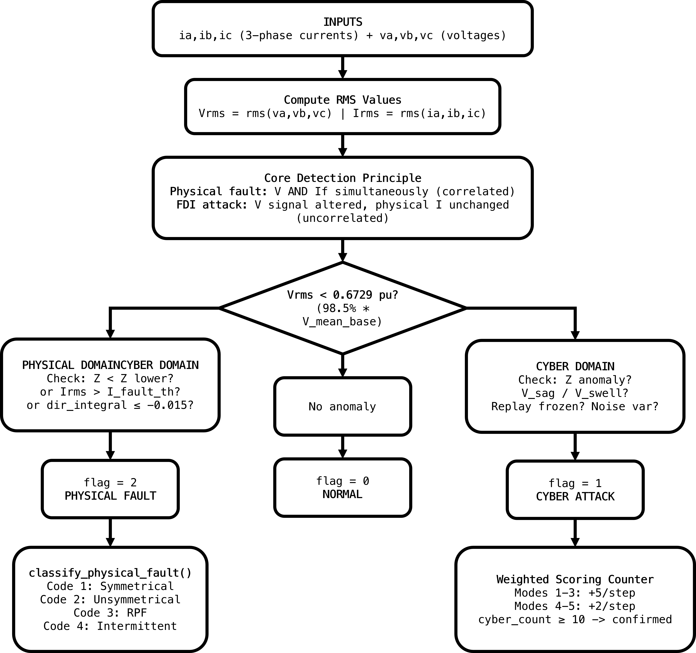
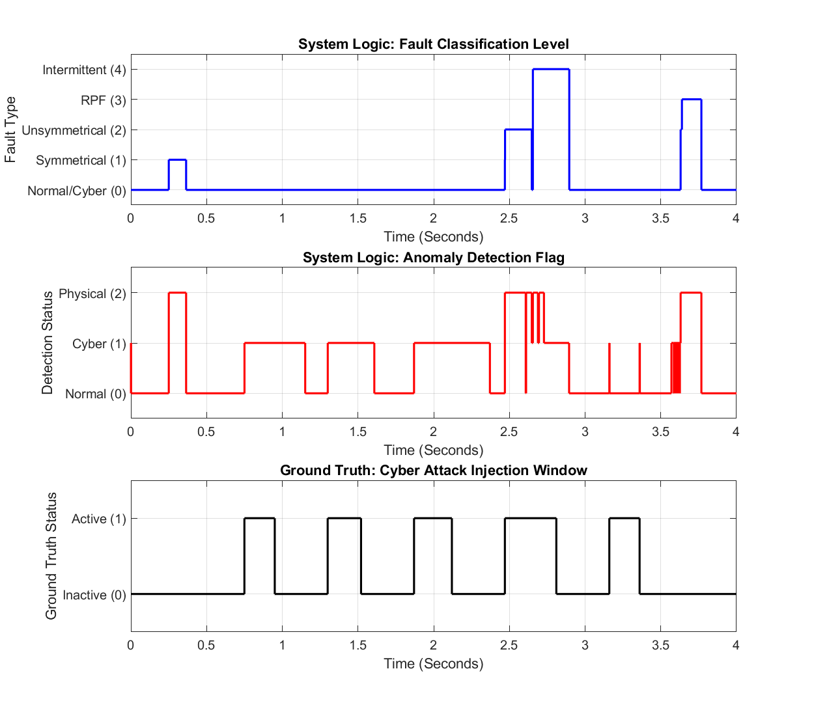
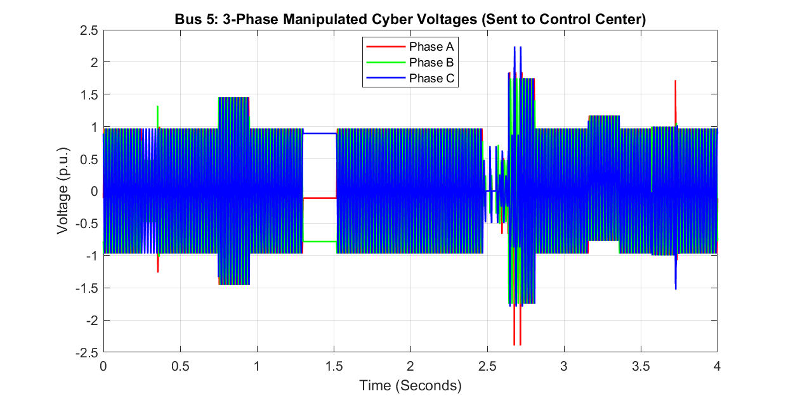
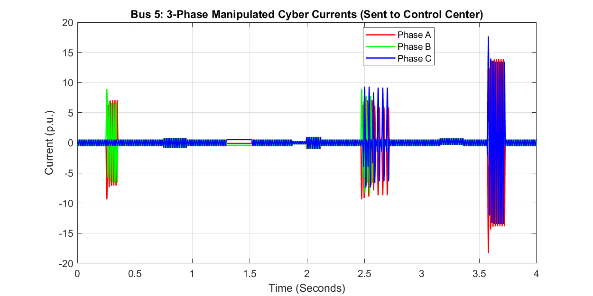
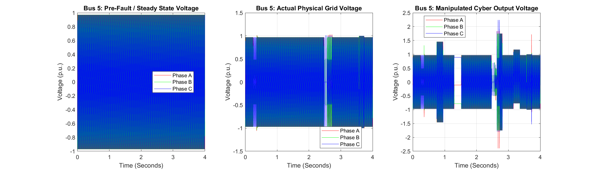
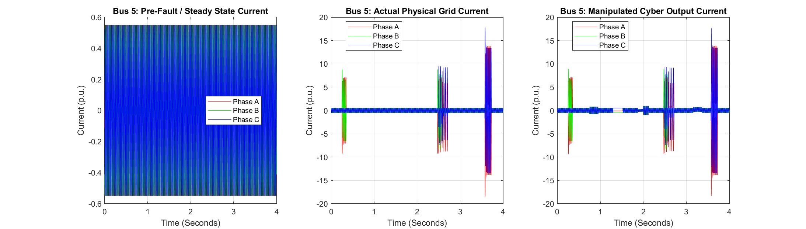
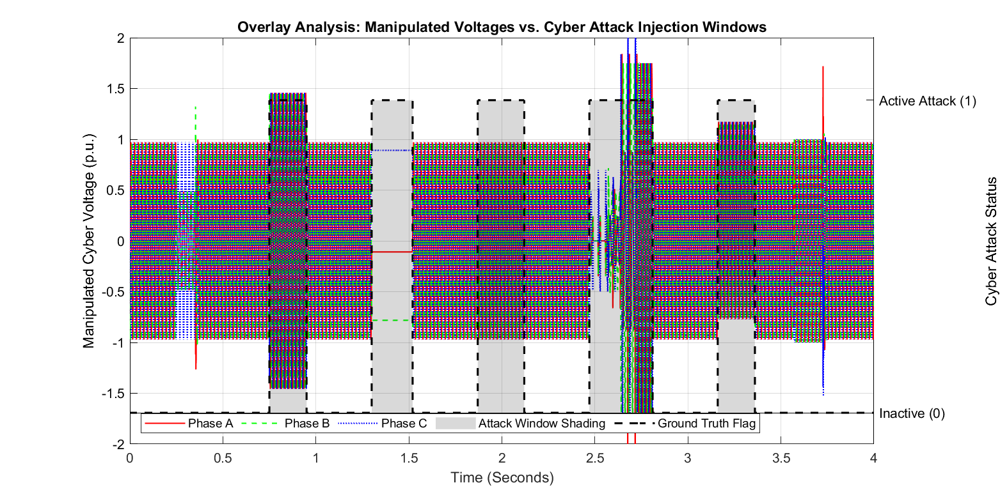

# Simulating Power Grid Cyber-Attacks: Utilizing V-I Correlation to Differentiate FDI Attacks from Physical Faults


A MATLAB/Simulink project that implements a **real-time, physics-based anomaly detection scheme** for a 5-bus transmission network. It distinguishes **False Data Injection (FDI) cyber-attacks** from **genuine physical faults** using the correlation (or lack of it) between voltage and current, and sub-classifies detected physical faults into four categories useful for protective relaying: symmetrical, unsymmetrical, **reverse power flow (RPF)** and intermittent.

> B.Tech Project, School of Electrical Sciences, Odisha University of Technology and Research, Bhubaneswar
> Author: **Ujjwal Keshri** (Reg. No. 23110546) | Supervisor: **Prof. A. K. Barisal** | 2025-26
> Full report: [`docs/PPD_report_final.pdf`](docs/PPD_report_final.pdf)

---

## Table of Contents

- [Overview](#overview)
- [Key Features](#key-features)
- [How It Works](#how-it-works)
- [Repository Structure](#repository-structure)
- [System Model](#system-model)
- [Detection Algorithm: `detect_fdi()`](#detection-algorithm--detect_fdi)
- [Sub-Classification Algorithm: `classify_physical_fault()`](#sub-classification-algorithm--classify_physical_fault)
- [Requirements](#requirements)
- [Getting Started](#getting-started)
- [Usage](#usage)
- [Outputs and Diagnostic Figures](#outputs-and-diagnostic-figures)
- [Results Summary](#results-summary)
- [Limitations](#limitations)
- [Comparison with Other Approaches](#comparison-with-other-approaches)
- [Future Scope](#future-scope)
- [References](#references)
- [Citation](#citation)
- [License](#license)
- [Acknowledgements](#acknowledgements)

---

## Overview

Modern smart grids depend on SCADA systems for real-time monitoring and control, which makes them vulnerable to **False Data Injection (FDI) attacks**: stealthy attacks in which an adversary manipulates sensor measurements without tripping conventional bad-data-detection (BDD) alarms. A key operational blind spot is that protective relays often cannot quickly tell whether a sudden voltage anomaly is a **cyber-attack** or a **real physical fault**. Getting it wrong has serious consequences: unnecessary outages on one side, unprotected equipment damage on the other.

This project implements two MATLAB functions that together form a lightweight, model-free, real-time detection pipeline:

1. **`detect_fdi()`** classifies the system state at every simulation step as:
   - `0`: Normal
   - `1`: Cyber-Attack (FDI)
   - `2`: Physical Fault
2. **`classify_physical_fault()`** runs when a physical fault is flagged and sub-classifies it as:
   - `1`: Symmetrical (3-phase) fault
   - `2`: Unsymmetrical (line-to-ground) fault
   - `3`: Reverse Power Flow (RPF) fault
   - `4`: Intermittent fault (highest priority)

The core idea is **V-I correlation**. A genuine physical fault causes voltage collapse *and* a current surge at the same time (the two move together), whereas an FDI attack in this model changes only the reported voltage while the true physical current stays unchanged (the two disagree).

Reverse power flow is handled as a physical fault: power flowing back into a generator (motoring) is an abnormal operating condition that protection must act on, so the detector raises `flag = 2` for it and reports `fault_code = 3`.

---

## Key Features

- **No network model or training data required.** The scheme is threshold- and physics-based, unlike state-estimation or ML-based intrusion detection.
- **Real-time capable:** runs at `Ts = 50 µs` (20 kHz), which is within relay time scales.
- **Detects 5 FDI attack modes:** Fake-Short, Fake-Sag, Fake-Swell, Replay Attack, Noise Injection.
- **Sub-classifies 4 physical fault types:** Symmetrical, Unsymmetrical, Reverse Power Flow, Intermittent.
- **Weighted event-scoring counter** with blanking and holdoff logic to suppress false positives during and after physical faults and while a breaker is open.
- **Dual-flag output** (`flag` + `flag_cyber_raw`) so simultaneous cyber and physical events can be reported independently.
- **Documented thresholds:** every constant is derived from baseline per-unit measurements (see [Detection Algorithm](#detection-algorithm--detect_fdi)).
- **Diagnostic figures** for visual ground-truth validation, including a combined waveform and detection-flag overlay.

---

## How It Works

The detector computes RMS voltage (`Vrms`) and RMS current (`Irms`) at Bus 5 and applies a single **voltage-boundary separator**:

```
V_boundary = 0.985 x V_mean_base = 0.6769 pu

is_phys_voltage  = (Vrms <  0.6769 pu)   -> Physical domain
is_cyber_voltage = (Vrms >= 0.6769 pu)   -> Cyber domain
```

- An impedance or current anomaly seen **while `is_phys_voltage` is true** is treated as a **physical fault** (`flag = 2`).
- The same kind of anomaly seen **while `is_cyber_voltage` is true** is treated as an **FDI event** (`flag = 1`).

This boundary rule is reinforced by a **weighted cyber-event scoring counter** and a **reverse-power-flow (RPF) integrator**.

```
        INPUTS: ia, ib, ic, va, vb, vc
                     |
          Compute Vrms, Irms (RMS values)
                     |
     Core principle: physical fault -> correlated V and I
                      FDI attack    -> uncorrelated V and I
                     |
        +------------+------------+
        |  Vrms < 0.6769 pu ?     |
        +------------+------------+
     Yes ------------+------------ No
        |                           |
 PHYSICAL DOMAIN               CYBER DOMAIN
 Z < Z_lower? Irms >           Z anomaly? V sag/swell?
 I_fault_th? dir_integral      Replay frozen? Noise variance?
 <= -0.015?                           |
        |                             |
   flag = 2 (PHYSICAL)          flag = 1 (CYBER)
        |                             |
classify_physical_fault()      Weighted scoring counter
 Code 1: Symmetrical           (+5 / +2 per step,
 Code 2: Unsymmetrical          decays -5/step,
 Code 3: Reverse Power Flow     confirmed at >= 10)
 Code 4: Intermittent
```

<!-- TODO (author): the Fake-Sag threshold (V_sag_th = 0.6528 pu) is below V_boundary (0.6769 pu), yet the cyber domain is defined as Vrms >= V_boundary. Check the MATLAB Function block and state here how a fake sag is still classified as cyber (for example, whether the sag mode is evaluated on the manipulated signal path before the domain test). -->

---

## Repository Structure

```
Cyber-attack-and-physical-fault-differentiation
├── data
│   ├── B5_AfterFault_data.csv           # Bus 5 3-phase V/I after a physical fault
│   ├── B5_BeforeFault_data.csv          # Bus 5 3-phase V/I, healthy steady state
│   └── Cyber_Physical_System_Data.csv   # Full 4 s run: cyber V/I + fault_classification, flag_detection, flag_cyber
├── docs
│   └── PPD_report_final.pdf             # Project report
├── figures                              # Diagnostic plots (see Outputs and Diagnostic Figures)
├── model
│   └── grid_5bus_fdi_detection.slx      # Simulink model (5-bus network + detect_fdi / classify_physical_fault blocks)
└── scripts
    ├── data_extraction.m                # Menu-driven export of logged 3-phase V/I data to CSV
    ├── plotting.m                       # Generates the diagnostic figures
    └── threshold_calculator.m           # Derives V / I / Z baselines and thresholds
```

> `detect_fdi()` and `classify_physical_fault()` live inside `model/grid_5bus_fdi_detection.slx` as MATLAB Function blocks.

---

## System Model

| Parameter | Value |
|---|---|
| System base | 100 MVA |
| Buses | 5 (2 generator + 3 load) |
| Transmission lines | 6 |
| Bus 1 (Slack) | 1.06 pu, 0 deg |
| Bus 2 (Generator) | 1.00 pu (regulated) |
| Total active load | ~283 MW |
| Solver | `ode4` fixed-step (Specialized Power Systems) |
| Sample period (Ts) | 50 µs (20 kHz) |
| Nominal frequency | 50 Hz |
| Monitoring point | Bus 5 (FDI injection point) |
| Simulation length | 4 s (80,001 samples in the logged data) |

The FDI attack is implemented as a **signal-path bias injection** between the true physical voltage measurement and the input to `detect_fdi()`. It never touches the physical network, so the true line currents stay unchanged. This is the asymmetry the detector exploits.

---

## Detection Algorithm: `detect_fdi()`

### Baseline parameters (from healthy steady-state simulation)

`Vrms` and `Irms` are computed from the instantaneous three-phase signals, and `Z = Vrms / Irms`.

| Symbol | Value | Meaning |
|---|---|---|
| `Z_mean_base` | 1.7702 pu | Steady-state V/I ratio at Bus 5 |
| `I_mean_base` | 0.3882 pu | Normal RMS current magnitude |
| `V_mean_base` | 0.6872 pu | Normal RMS voltage magnitude |
| `V_boundary` | 0.6769 pu | 98.5% of `V_mean_base`; cyber/physical separator |

### Derived thresholds

| Threshold | Formula | Value | Purpose |
|---|---|---|---|
| `Z_upper` | 1.25 x Z_mean_base | 2.2128 pu | High-impedance boundary |
| `Z_lower` | 0.75 x Z_mean_base | 1.3277 pu | Low-impedance (short-circuit) boundary |
| `I_fault_th` | 1.30 x I_mean_base | 0.5047 pu | Overcurrent / fake-short threshold |
| `I_breaker` | 0.30 x I_mean_base | 0.1165 pu | Dead-bus / breaker-open suppression |
| `V_sag_th` | 0.95 x V_mean_base | 0.6528 pu | Fake-sag boundary |
| `V_swell_th` | 1.05 x V_mean_base | 0.7216 pu | Fake-swell boundary |
| Noise threshold | 20 x (0.02 x I_mean)^2 | 0.001206 | Rolling-variance threshold |
| RPF threshold | `dir_integral <= -0.015 pu·s` | n/a | Reverse power-flow gate |

The percentage margins (75%, 125%, 130%, 95%, 105% and so on) are engineering choices applied on top of the measured baseline. `scripts/threshold_calculator.m` also prints 3-sigma statistical bounds for comparison.

### FDI attack modes detected

| # | Mode | Condition | Score per step |
|---|---|---|---|
| 1 | Fake-Short | `Z < Z_lower` AND `Irms > I_fault_th`, cyber-voltage domain | +5 |
| 2 | Fake-Sag | `Vrms < V_sag_th` AND `Irms > 0.5 x I_mean` | +5 |
| 3 | Fake-Swell | `Vrms > V_swell_th` AND `Irms > 0.2717 pu` | +5 |
| 4 | Replay Attack | `delta_v < 1e-3` for more than 5 consecutive steps | +2 |
| 5 | Noise Injection | rolling 20-sample variance > 0.001206 | +2 |

A **weighted scoring counter** (`cyber_count`) accumulates these scores, decays by 5 per step when no condition is active, and confirms a cyber-attack once `cyber_count >= 10`. The counter is reset and blanked for 200 steps (10 ms) after a physical fault clears, and while the breaker is open (`Irms < I_breaker`).

### Timing parameters

| Parameter | Value | Duration |
|---|---|---|
| Sample period (Ts) | 50 µs | n/a |
| Physical fault confirm | `fault_count >= 3` | 150 µs |
| Fault latch duration | 250 steps | 12.5 ms |
| Cyber holdoff post-fault | 200 steps | 10.0 ms |
| Replay frozen threshold | `frozen_count > 5` | 250 µs |
| Noise buffer size | 20 samples | 1.0 ms |
| Intermittent window | 4000 steps | 200 ms |
| RMS rolling buffer | 400 samples | 20 ms (1 cycle) |

**Function I/O**
```
Inputs : ia, ib, ic, va, vb, vc   (instantaneous 3-phase currents and voltages)
Outputs: flag (0/1/2), flag_cyber_raw
Persistent state: cyber_count, fault_count, fault_latch, dir_integral,
                  frozen_count, noise_var_buf, is_rpf_active
```

---

## Sub-Classification Algorithm: `classify_physical_fault()`

Active only when `flag == 2`. It outputs a `fault_code` (0-4) using a strict priority ladder:

| Code | Fault type | Criterion | Priority |
|---|---|---|---|
| 0 | Normal | `flag != 2` (gatekeeper) | n/a |
| 4 | Intermittent | 3 or more `flag = 2` transitions within 200 ms | **Highest** (overrides all) |
| 3 | Reverse Power Flow | `dir_integral <= -0.015 pu·s` during `flag = 2` | 2nd |
| 2 | Unsymmetrical (L-G) | phase-current unbalance > 15% | 3rd |
| 1 | Symmetrical (3-phase) | phase-current unbalance <= 15% (default) | Lowest |

Phase-current unbalance is computed from rolling 400-sample (one cycle) RMS buffers:

```
unbalance = max(|Ia_rms - Iavg|, |Ib_rms - Iavg|, |Ic_rms - Iavg|) / Iavg_rms
```

**Function I/O**
```
Inputs : ia, ib, ic, va, vb, vc, flag (from detect_fdi)
Outputs: fault_code (0-4)
```

---

## Requirements

- MATLAB R2023a or later (older versions are untested)
- Simulink
- Simscape Electrical, **Specialized Power Systems** library
- No other toolboxes or external datasets

---

## Getting Started

```bash
git clone https://github.com/RustyUjjwal/Cyber-attack-and-physical-fault-differentiation.git
cd Cyber-attack-and-physical-fault-differentiation
```

1. Open MATLAB and set the repository root as the working directory (or add it to the path).
2. Open `model/grid_5bus_fdi_detection.slx` in Simulink.
3. Run the simulation (4 s, fixed step 50 µs).
4. Export the logged signals with `scripts/data_extraction.m`, then derive baselines and generate plots as described below.

---

## Usage

The scripts are **interactive and expect specific file names in the current MATLAB folder**, so copy or rename the files from `data/` as shown.

### 1. Export logged data: `scripts/data_extraction.m`

Run after the Simulink simulation so the logged signals are in the MATLAB workspace. A menu asks for one bus or all buses, then writes per-bus CSV files named `z_B<bus>_<tag>_data.csv` (for example `z_B5_BeforeFault_data.csv`) and the combined `Cyber_Physical_System_Data.csv` with columns `cyber_I_Phase{A,B,C}`, `cyber_V_Phase{A,B,C}`, `fault_classification`, `flag_detection`, `flag_cyber`.

### 2. Derive baselines and thresholds: `scripts/threshold_calculator.m`

Reads `z_B<bus>_data.csv` (columns `Va_B<n>`, `Vb_B<n>`, `Vc_B<n>`, `Ia_B<n>`, `Ib_B<n>`, `Ic_B<n>`), prints mean/std/min/max of Z, V, I and P, and compares 3-sigma bounds against the practical thresholds used by the detector. Use a healthy-state file such as `data/B5_BeforeFault_data.csv`, copied and renamed to `z_B5_data.csv`.

### 3. Generate figures: `scripts/plotting.m`

Reads three files from the current folder:

| Expected by `plotting.m` | Repository file |
|---|---|
| `Cyber_Physical_System_Data_Perfected.csv` | `data/Cyber_Physical_System_Data.csv` |
| `z_B5_BeforeFault_data.csv` | `data/B5_BeforeFault_data.csv` |
| `z_B5_AfterFault_data.csv` | `data/B5_AfterFault_data.csv` |

Copy the repository files to the current folder under the names in the left column, then run `plotting.m`. Figures are saved to the current folder; move them into `figures/` afterwards.

### Using the functions standalone

`detect_fdi()` and `classify_physical_fault()` are MATLAB Function blocks inside `model/grid_5bus_fdi_detection.slx`. To run them outside Simulink, open each block, copy its code into a `.m` file of the same name on the MATLAB path, and call it on your own V-I streams:

```matlab
[flag, flag_cyber_raw] = detect_fdi(ia, ib, ic, va, vb, vc);
fault_code = classify_physical_fault(ia, ib, ic, va, vb, vc, flag);
```

> Both functions use **persistent variables**. Run `clear functions` between independent runs.

---

## Outputs and Diagnostic Figures

All figures are in [`figures/`](figures/). They are produced by `scripts/plotting.m` from the logged simulation data.

### Detection logic


*Detection flowchart: RMS values feed a single voltage-boundary test that routes the signal to the physical domain (flag = 2, then `classify_physical_fault()`) or the cyber domain (flag = 1, weighted scoring counter).*

<!-- TODO (author): this flowchart shows the voltage boundary as 0.6729 pu, but the thresholds in this README give 0.985 x 0.6872 = 0.6769 pu. Also the left box title reads "PHYSICAL DOMAINCYBER DOMAIN". Fix the image so it matches. -->

### System response over the 4 s run (Fig. 5.1)


*Top: `fault_code` (0 = normal/cyber, 1 = symmetrical, 2 = unsymmetrical, 3 = RPF, 4 = intermittent). Middle: `flag` (0 = normal, 1 = cyber, 2 = physical). Bottom: ground-truth cyber-attack injection windows.*

### Manipulated measurements at Bus 5 (Fig. 5.2 and 5.3)


*Fig. 5.2: Bus 5 manipulated three-phase voltages as seen by the detector.*


*Fig. 5.3: Bus 5 three-phase currents over the same run (the true physical current is not altered by the injected attack).*


*Fig. 5.2 as saved by `plotting.m`.*


*Fig. 5.3 as saved by `plotting.m`.*

### Pre-fault vs physical vs manipulated signals (Fig. 5.4 and 5.5)


*Fig. 5.4A-C: pre-fault steady state, actual physical grid, and manipulated cyber output (voltage).*


*Fig. 5.5A-C: pre-fault steady state, actual physical grid, and manipulated cyber output (current).*

Individual panels:


*Subplot 1: pre-fault steady state (voltage).*


*Subplot 2: actual physical grid (voltage).*


*Subplot 3: manipulated cyber output (voltage).*


*Subplot 1: pre-fault steady state (current).*


*Subplot 2: actual physical grid (current).*


*Subplot 3: manipulated cyber output (current).*

### Key validation plot (Fig. 5.6)


*Fig. 5.6: manipulated three-phase voltages with the ground-truth attack windows (grey shading and dashed line). Five injection windows are visible between about 0.75 s and 3.36 s; physical faults occur at about 0.25 s, 2.47 s, 2.65 s and 3.63 s.*

## Results Summary

All results below come from a single 4 s simulation of the 5-bus model in which every attack mode and fault type is injected in sequence.

- **All 5 FDI attack modes** were detected (`flag = 1`), with **no spurious physical-fault alarms** (`fault_code = 0` during every cyber window).
- **All 4 physical fault types** were sub-classified correctly (including reverse power flow), with physical faults detected within **150 µs (3 samples)** of inception.
- **Cyber detection latency:** about 100 µs for magnitude-based attacks (modes 1-3) and about 250 µs for pattern-based attacks (replay and noise, modes 4-5).
- The dual-flag output prioritises physical-fault relay action while independently signalling a co-occurring cyber intrusion.
- **Check against the logged data** (`data/Cyber_Physical_System_Data.csv`, injection windows read from Plot 1C): `flag_cyber` is active for 97-100% of the samples in each of the five injection windows and for about 0.4% of the samples outside them. In the window that overlaps a physical fault (about 2.47-2.82 s) `flag` reports the physical fault for most of the window while `flag_cyber` stays active, as designed. `flag` also stays at 1 for a short time after some windows end, and in the last window (about 3.17-3.36 s) `flag` stays at 0 while `flag_cyber` is 1, so use `flag_cyber` as the cyber-attack indicator.

<!-- TODO (author): explain in this section why `flag` stays 0 during the last injection window (about 3.17-3.36 s) while `flag_cyber` is 1, and why `flag` holds at 1 briefly after windows end. -->

| Attack mode | Condition | flag | fault_code |
|---|---|---|---|
| Fake-Short | `Z < 1.3277`, cyber-voltage domain | 1 | 0 |
| Fake-Sag | `Vrms < 0.6528`, cyber-voltage domain | 1 | 0 |
| Fake-Swell | `Vrms > 0.7216`, cyber-voltage domain | 1 | 0 |
| Replay Attack | frozen > 250 µs | 1 | 0 |
| Noise Injection | rolling variance > 0.001206 | 1 | 0 |

| Fault type | Detection criterion | flag | fault_code |
|---|---|---|---|
| Symmetrical (3-phase) | 150 µs, unbalance <= 15% | 2 | 1 |
| Unsymmetrical (L-G) | 150 µs, unbalance > 15% | 2 | 2 |
| Reverse Power Flow | `dir_integral <= -0.015 pu·s` | 2 | 3 |
| Intermittent | 3 transitions within 200 ms | 2 | 4 |

---

## Limitations

- Validated only in simulation, on one 5-bus network, at a single monitoring bus (Bus 5). No hardware or real measurement data was used.
- Thresholds were derived from the same network they are tested on, so they must be recalibrated for a different topology or loading.
- The cyber/physical boundary is narrow (98.5% of the healthy voltage), and the scheme assumes the attacker alters only the voltage measurement. Coordinated attacks (FDI during a real fault) and multi-point attacks were not tested.
- Measurement noise, CT/VT errors and communication delays were not modelled in detail.

---

## Comparison with Other Approaches

A qualitative comparison based on the literature. No head-to-head benchmark was run, so the entries describe typical characteristics, not measured results.

| Aspect | This work (V-I correlation) | State-estimation BDD | ML-based IDS | Data-driven (Anwar et al.) |
|---|---|---|---|---|
| Network model needed | No | Yes (Y-bus) | No | No |
| Training data needed | No | No | Yes (large) | Yes |
| Typical operation | Sample-by-sample, 50 µs | Per estimation cycle | Batch / inference | Offline analysis |
| Fault sub-classification | 4 types | Typically none | Possible | Typically none |
| Dual flag output | Yes | No | No | No |
| False-positive suppression | Weighted counter and blanking | Thresholds | Model-dependent | Statistical |

---

## Future Scope

- Extend to larger benchmark networks (IEEE 14-, 30-, 118-bus) to test scalability.
- Investigate **coordinated attacks** (FDI during an active physical fault).
- Integrate PMU synchrophasor data to improve RPF and intermittent-fault sensitivity.
- Add adaptive baseline calibration for `V_mean_base`, `I_mean_base`, `Z_mean_base` under changing load.
- Hardware-in-the-loop validation on RTDS / OPAL-RT.
- Extend to inverter-dominated microgrids with different fault-current signatures.
- Explore multi-point FDI attacks across several buses and sensors.
- Align with **IEC 62351** (cybersecurity) and **IEC 61850** (substation automation).

---

## References

1. A. Anwar, A. N. Mahmood, Z. Tari, "A data-driven approach to distinguish cyber-attacks from physical faults in a smart grid," *Proc. 8th Int. Conf. Secur. Inf. Netw. (SIN)*, 2015.
2. "Centralized dynamic state estimation algorithm for detecting and distinguishing faults and cyber-attacks in power systems," IEEE Xplore, 2025.
3. M. M. Aman, G. B. Jasmon, Q. A. Khan, A. H. B. Abu Bakar, J. J. Jamian, "Modeling and simulation of reverse power relay for generator protection," *Proc. IEEE Int. Power Eng. Optim. Conf. (PEOCO)*, 2012, pp. 317-322.
4. S. Sridhar, A. Hahn, M. Govindarasu, "Cyber-physical system security for the electric power grid," *Proc. IEEE*, vol. 100, no. 1, pp. 210-224, 2012.
5. V. S. Rajkumar, M. Tealane, A. Stefanov, A. Presekal, P. Palensky, "Cyber Attacks on Power System Automation and Protection and Impact Analysis," *2020 IEEE PES Innovative Smart Grid Technologies Europe (ISGT-Europe)*, 2020. doi: 10.1109/ISGTEurope47291.2020.9248840

---

## Citation

If you use this work, please cite:

```
Ujjwal Keshri, "Simulating Power Grid Cyber-Attacks: Utilizing V-I Correlation to
Differentiate FDI Attacks from Physical Faults," B.Tech Project Report, School of
Electrical Sciences, Odisha University of Technology and Research, Bhubaneswar, 2026.
```

---

## License

Released under the MIT License. See [LICENSE](LICENSE).

---

## Acknowledgements

Developed under the guidance of **Prof. A. K. Barisal**, Professor, School of Electrical Sciences, Odisha University of Technology and Research, Bhubaneswar, as part of the B.Tech in Electrical Engineering curriculum (2025-26).
